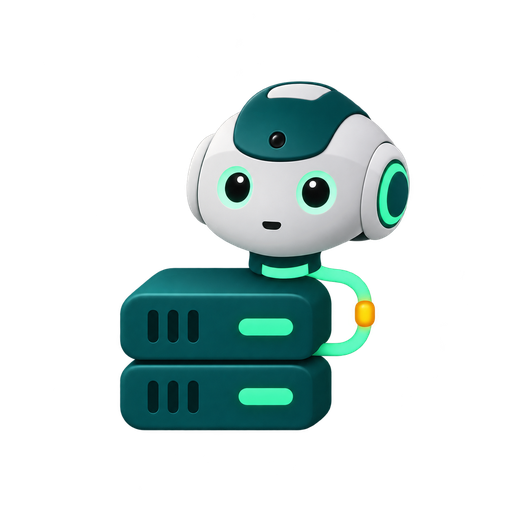
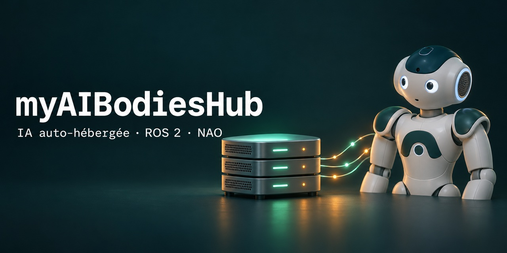
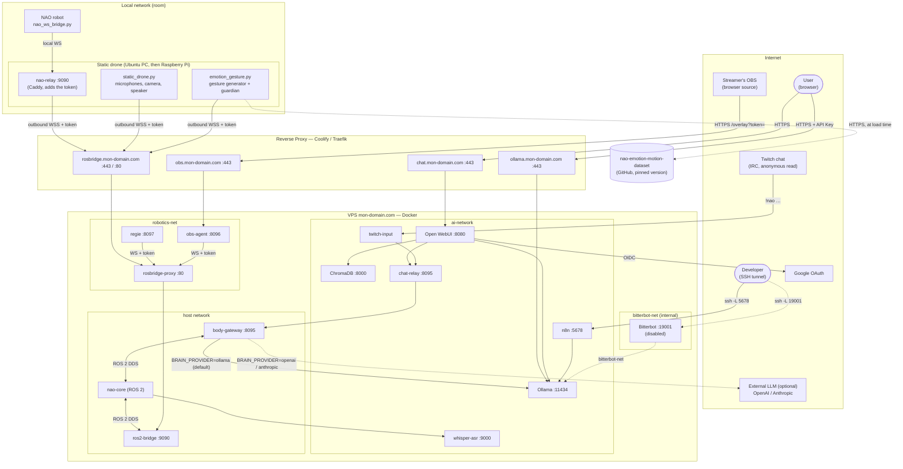

<h1>
  
  myAIBodiesHub — Unified AI stack
</h1>



# myAIBodiesHub — Unified AI stack

Self-hosted AI stack on an Ubuntu VPS, deployed with Docker Compose and managed by Coolify. It brings together an LLM engine, a chat interface, a workflow orchestrator, a vector memory, an autonomous agent and a robotics infrastructure (NAO through ROS 2).

## Documentation

| Section | Description |
|---|---|
| [Architecture](docs/architecture.md) | Vision, infrastructure, Docker networks |
| [Container overview](docs/containers-overview.md) | Summary table of all containers, inputs/outputs, formats |
| [AI stack](docs/ia-stack.md) | Ollama, Open WebUI, n8n, ChromaDB, Bitterbot |
| [AI / ROS 2 / NAO bridge](docs/bridge-ia-ros2-nao.md) | nao-core, body-gateway, ros2-bridge, ROS 2 topics |
| [NAO robot](docs/nao.md) | Bridge embedded on the robot, deployment, autostart |
| [Chain test](docs/test-chain.md) | Link-by-link diagnostics WebUI → NAO |
| [Coolify & VPS](docs/coolify-vps.md) | VPS requirements, Coolify deployment, CI/CD, cloud sync |
| [OBS overlays](docs/obs-overlays.md) | Placing the voice/subtitle and games overlays on the stream |

### Architecture decisions (ADR)

| ADR | Decision |
|---|---|
| [ADR 001](docs/decisions/001-ros2-over-ros1.md) | ROS 2 rather than ROS 1 |
| [ADR 002](docs/decisions/002-nao-websocket-bridge.md) | WebSocket bridge embedded on NAO (no VPN, no Raspberry Pi) |
| [ADR 003](docs/decisions/003-ollama-direct-sans-bitterbot.md) | Direct Ollama without Bitterbot for body-gateway |
| [ADR 004](docs/decisions/004-drone-statique.md) | Raspberry Pi static drone for the senses, NAO reduced to emotional rendering |
| [ADR 005](docs/decisions/005-avatar-twitch.md) | A single stimuli → LLM → actions loop: Twitch as an input, OBS as a voice |
| [ADR 006](docs/decisions/006-nao-via-drone-statique.md) | NAO only reaches the VPS through a relay on the static drone |
| [ADR 007](docs/decisions/007-regie-topic-events.md) | Control room: body-gateway publishes its streams on the standard ROS topic `/events` |
| [ADR 008](docs/decisions/008-univers-moteur-contraint.md) | Constrained motor universe: motor profile calibrated from the control room |
| [ADR 009](docs/decisions/009-gestes-appris.md) | Learned gestures (nao-emotion-motion): generated on the static drone, played by the robot |
| [ADR 010](docs/decisions/010-game-master.md) | Games with the viewers: `game-master` decides by code, the LLM only speaks |

---

## Architecture



All inputs ("ok nao" in the room, Open WebUI, Twitch chat, sensors) go through the
same loop: text → `body-gateway` (LLM) → list of actions spread across the bodies
(NAO, room voice, stream voice). See [ADR 005](docs/decisions/005-avatar-twitch.md).

The LLM is Ollama on the VPS by default; `BRAIN_PROVIDER=openai` or `anthropic`
(with `BRAIN_URL`, `BRAIN_MODEL`, `BRAIN_API_KEY`) sends the decisions to an external
LLM instead (see `robotics/brain/body_gateway/brain_client.py`).

Learned gestures ([ADR 009](docs/decisions/009-gestes-appris.md)) are computed on the
static drone by `emotion_gesture.py`: the LLM picks an emotion, the NAO driver (in
`nao-core`) passes it on, the drone generates the gesture, has it validated by the
guardian, then sends it to the NAO, which plays it. All these exchanges go through
rosbridge on the VPS.

---

## Repository layout

```
ia-agent/
├── core/bitterbot/          → Dockerfile + config template of the Bitterbot agent
├── robotics/
│   ├── brain/               → Generic brain, independent of the drone type
│   │   ├── body_gateway/    → ROS 2 brain: LLM ↔ robotic bodies
│   │   ├── ros2_bridge/     → rosbridge_server WebSocket Dockerfile
│   │   └── webui/           → Open WebUI pipe (nao_pipe.py)
│   ├── inputs/
│   │   └── twitch/          → Twitch chat input "!nao" → body-gateway (ADR 005)
│   ├── regie/               → Control room page: live /events stream (ADR 007)
│   ├── games/               → game-master: games with the viewers (ADR 010)
│   ├── shared/              → Shared classes (RobotBridgeBase)
│   └── drones/
│       ├── nao/
│       │   ├── onboard/     → nao_ws_bridge.py (script run ON the robot)
│       │   ├── bridge/      → Flask HTTP bridge to NAO (naoqi-bridge container)
│       │   ├── driver/      → ROS 2 node: topics → HTTP to naoqi-bridge
│       │   ├── cognitive_renderer/ → ROS 2 node: cognitive state → LEDs / head
│       │   └── core/        → Dockerfile + entrypoint of the nao-core container
│       ├── static/          → Static drone (ADR 004): onboard/ (Raspberry Pi / PC) + driver/ (VPS ROS 2 node)
│       ├── obs/             → NAO's voice on the stream: OBS overlay (ADR 005)
│       └── quadcopter/      → Reserved
├── docs/
│   ├── architecture.md
│   ├── containers-overview.md
│   ├── ia-stack.md
│   ├── bridge-ia-ros2-nao.md
│   ├── nao.md
│   ├── test-chain.md
│   ├── coolify-vps.md
│   ├── games.md
│   ├── obs-overlays.md
│   └── decisions/           → ADR (Architecture Decision Records)
├── tests/                   → test-chain.sh, NAO diagnostics, fake static drone
├── .github/workflows/
│   ├── build-bitterbot.yml  → Build + push $DOCKERHUB_USERNAME/bitterbot
│   └── build-robotics.yml   → Build + push of the 8 robotics images (naoqi-bridge, nao-core,
│                              body-gateway, ros2-bridge, twitch-input, obs-agent, regie, game-master)
├── setup-vps.sh             → VPS preparation (folders, firewall, tokens)
└── docker-compose.yml
```

---

## Quick access to the services

| Service | URL / command | Auth |
|---|---|---|
| Open WebUI | `https://chat.$DOMAIN` | Google SSO |
| Ollama API | `https://ollama.$DOMAIN` | `Authorization: Bearer $OLLAMA_API_KEYS` |
| n8n | `ssh -L 5678:localhost:5678 $VPS_USER@$DOMAIN` | Basic auth |
| Bitterbot | `ssh -L 19001:localhost:19001 $VPS_USER@$DOMAIN` | WS token |
| rosbridge | `wss://rosbridge.$DOMAIN` (NAO goes through the static drone's relay, ADR 006) | `Authorization: Bearer $ROSBRIDGE_TOKEN` |
| OBS overlay (stream voice) | `https://<obs-agent domain>/overlay?token=$OBS_TOKEN` (domain chosen in Coolify) (OBS browser source) | Token in the URL |
| Control room (streams between components) | `https://<regie domain>/?token=$REGIE_TOKEN` (domain chosen in Coolify) | Token in the URL |
